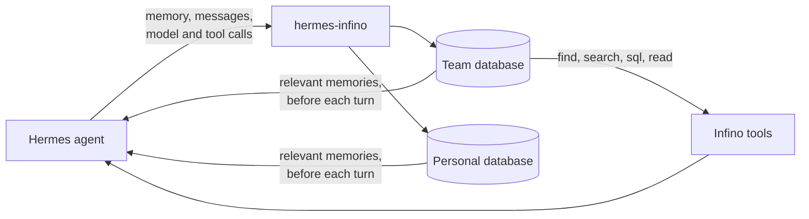
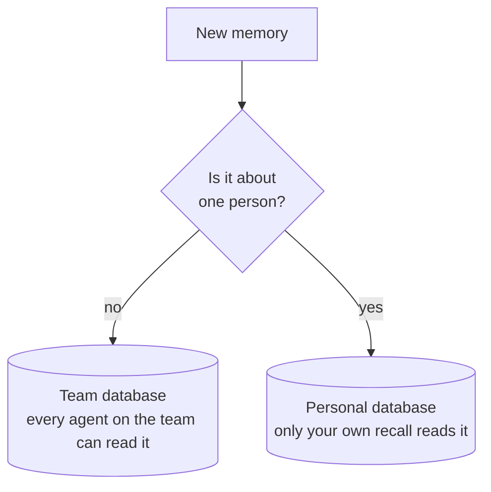
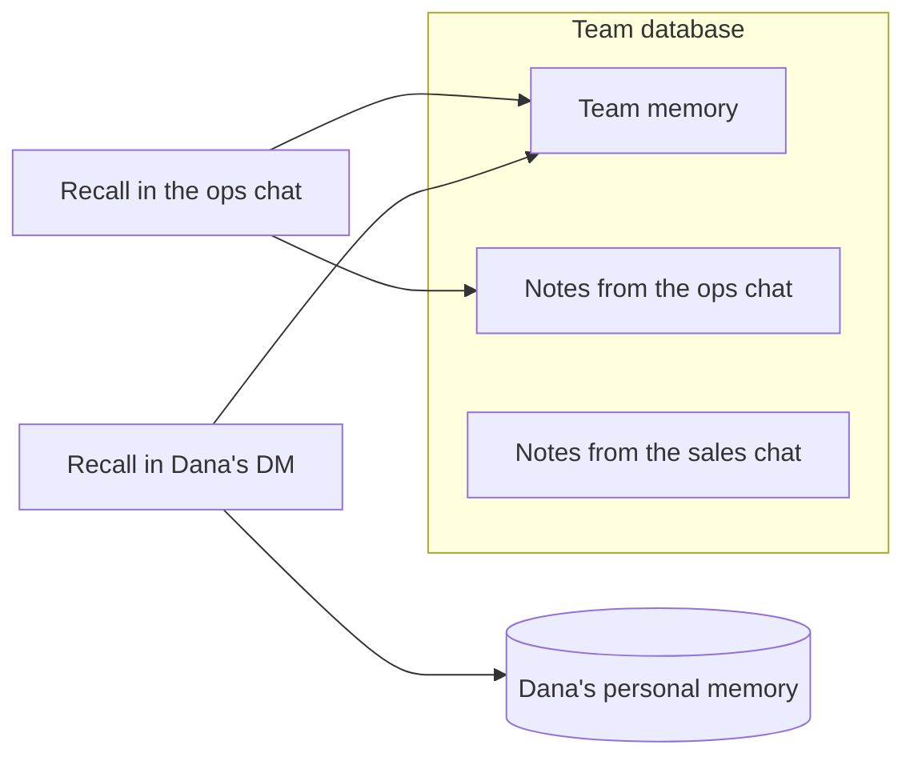
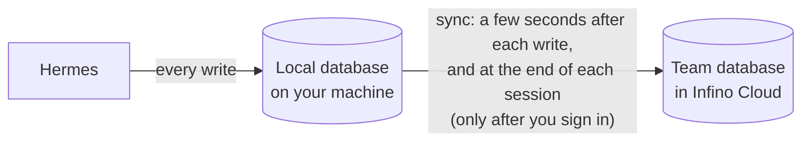
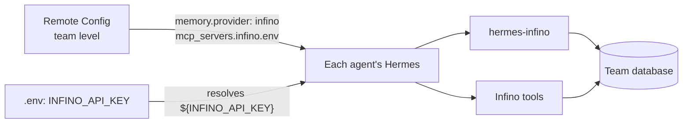

# hermes-infino

A [Hermes Agent](https://github.com/NousResearch/hermes-agent) plugin that stores the agent's memory and history in Infino.

It saves four things: memory, conversations, traces and skills. Before each turn it gives the agent the memories that matter for that turn. The agent can also search everything with the Infino tools.

You don't need an account. Without one, everything stays in a database on your machine. When you sign in, everything is copied to your team's database in Infino Cloud, and new data keeps going there.



## What it saves

| Table | What goes in it |
| --- | --- |
| `memory` | Everything written to Hermes's `MEMORY.md` and `USER.md`, and everything saved with the `infino_remember` tool. `infino_forget` deletes a memory. |
| `conversations` | Every message in every session, and who sent it. Tool calls and tool results are in their own columns. |
| `traces` | Every model call (model, provider, tokens, time taken) and every tool call (name, arguments, result, status, time taken). |
| `skills` | Skills shared with `infino_publish_skill`. Once signed in, every profile on the team can use them, as read-only `infino:<name>` skills. |

A conversation turn and its traces share a `session_id` and `turn_id`, so you can join them. Every row has a `row_id`.

Memories name the person they are about ("Dana prefers…"), never "the user", because teammates read them too. When recalled memories are added to a turn, they are marked as reference material, not as instructions for the agent.

## Team memory and personal memory

Memory belongs to the team unless it is about one person. Nobody has to say "team": the agent decides from what the memory is about.

| Goes to team memory | Goes to personal memory |
| --- | --- |
| Decisions, conventions, fixes, who owns what, how things are set up | A person's preferences, credentials, schedule, private matters |
| Hermes's `MEMORY.md` | Hermes's `USER.md` |
| `infino_remember` (the default) | `infino_remember` when the agent marks it personal |



Personal memory lives in a separate database. The Infino tools never open it, so no other agent and no chat can read it. On your machine it is `$HERMES_HOME/infino/personal`. When you sign in it goes to your personal database (`--personal-database`). If you don't have one, it stays on your machine. It never goes to the team database.

## Group chats

When Hermes is in a group chat through the gateway, memory belongs to that chat:

- What members ask the agent to remember is saved for that chat and credited to the person who said it. It never goes into anyone's personal memory.
- Recall in the group shows that chat's notes and team memory. It does not show anyone's personal memory or other chats' notes.
- Recall anywhere else (a direct message, another group) does not show that group's notes.



Which chat a message comes from, and whether that chat is a group, comes from Hermes. With Hermes's channel memory, its setting for the chat decides, including whether someone may write to the owner's personal memory from a group. Without channel memory, every chat except a direct message counts as a group.

**The tools are not separated by chat.** Recall keeps each chat's notes to that chat, but the Infino tools search the whole team database, so an agent can find another chat's notes and conversations with them. Separating chats in the tools needs per-chat permissions, which this version does not have.

## On your machine, and in the cloud



**Without an account**, everything is stored under `$HERMES_HOME/infino/` using the Infino engine. Each memory is embedded on your machine with all-MiniLM-L6-v2 (384 dimensions). Recall uses both keyword search and vector search. Nothing leaves your machine.

**After you sign in**:
- Every row is still written to your machine first. A sync then sends it to the cloud.
- The sync sends rows in the order they were saved and picks up where it stopped. If the cloud is down or refuses a write, nothing is lost and nothing is sent twice. `hermes infino status` shows how far behind the cloud is, and why the last sync stopped if it did.
- A forgotten memory is deleted from the cloud too.
- The cloud embeds memory itself, so your machine stops embedding.
- Recall reads the cloud first and adds any rows on your machine that the cloud doesn't have yet. If the cloud can't be reached, recall searches your machine's own rows by keyword.

## The Infino tools

Hermes runs the Infino client as an MCP server, started by the plugin's `mcp_launch.py`. Each time it starts, it checks whether you are signed in:
- **Not signed in:** the tools (`find`, `search`, `sql`, `read`) search the database on your machine.
- **Signed in:** the same tools search the team's database in the cloud, plus anything else the cloud offers.

The API key is passed to the client in its environment, never on its command line. Hermes does not show an MCP server's instructions to the model, so the plugin adds them to the system prompt.

## Install

1. Build the Infino client (needs Node.js 22.19 or newer): the `client/` folder of `infino-ai/ask-bench`, branch `feat/local-database-mode`.
2. Copy `hermes_infino/` to `$HERMES_HOME/plugins/infino/`. Hermes installs the Python dependencies listed in `plugin.yaml`. The engine is pinned to `infino==0.11.15`, the version the client uses to read the local database.
3. Add this to `config.yaml`:

```yaml
memory:
  provider: infino
mcp_servers:
  infino:
    command: /path/to/hermes/venv/bin/python   # the Python Hermes runs with, which has the dependencies
    args: [/path/to/.hermes/plugins/infino/mcp_launch.py]
    env:
      HERMES_HOME: /path/to/.hermes
      INFINO_CLIENT: /path/to/client/dist/cli.js
      INFINO_NODE: /path/to/node          # optional; otherwise `node` on PATH
    connect_timeout: 120
tool_budget:
  mcp_result_size_chars: 60000   # the client returns up to 60,000 characters; Hermes's default limit is 50,000
```

The first time a memory is saved or searched, the embedding model is downloaded from Hugging Face (about 90 MB, once).

## Signing in

```bash
hermes infino login                          # create a free Infino account
hermes infino login --api-key-file KEY \
  --team-database TEAM [--personal-database ME]   # join a team with a key someone gave you
hermes infino status                         # how far behind the cloud is
hermes infino sync                           # send what the cloud doesn't have yet, now
```

Before creating anything or sending anything, `login` tells you exactly what will be uploaded and asks you to confirm. Only a person at a terminal can agree to create an account: with no terminal, it refuses, and no flag can answer for you. When you sign in with a key someone gave you, `--yes` confirms the upload. The key is saved in `$HERMES_HOME/infino/credentials.json`, which only you can read.

Recall uses the cloud from the next turn. The Infino tools switch to the cloud when Hermes restarts. Until then they search the copy on your machine, which has everything too.

## Fleets: settings from config or Remote Config

A fleet doesn't run `login` on each machine. It puts the team's settings in the `env` block of the Infino tools' entry in `config.yaml`, and the plugin and its tools both read them from there:

```yaml
memory:
  provider: infino
mcp_servers:
  infino:
    command: /path/to/hermes/venv/bin/python
    args: [/path/to/.hermes/plugins/infino/mcp_launch.py]
    env:
      HERMES_HOME: /path/to/.hermes
      INFINO_CLIENT: /path/to/client/dist/cli.js
      INFINO_TEAM_DATABASE: support-team
      INFINO_API_KEY: ${INFINO_API_KEY}    # a reference; the key itself is in the profile's .env
    connect_timeout: 120
```

With Hermes's [Remote Config](https://github.com/NousResearch/hermes-agent/pull/122509), the same keys come from the config service instead of a file, so an administrator sets the team database once, at the team (group) level, and every agent on the team starts with it. Remote Config refuses a key written out in full, so `INFINO_API_KEY` stays a `${INFINO_API_KEY}` reference, and the key goes in each profile's `.env`. `hermes infino status` says where the settings came from ("from the config").



## Settings

Settings are read from three places; the first that has a value wins:
1. the `env` block of `mcp_servers.infino` in the profile's config (a file or Remote Config);
2. the profile's environment (`.env`);
3. the sign-in `hermes infino login` saved.

The config block comes first because Hermes starts the Infino tools with that block as their environment, so the plugin and its tools always use the same team. A `${VAR}` reference whose variable isn't set counts as not set.

| Variable | What it is |
| --- | --- |
| `INFINO_API_KEY` | The Infino API key for this person or bot |
| `INFINO_TEAM_DATABASE` | The team's database |
| `INFINO_PERSONAL_DATABASE` | This person's database. Leave it unset for bots and shared profiles. |
| `INFINO_AUTHOR` | Who this profile's messages and memories are from, when Hermes doesn't say. In a chat, the sender is always the author, and a message with no sender is saved without one. |
| `INFINO_MCP_SERVER` | The client's name under `mcp_servers` (default `infino`). Environment only, since it names the config block. |
| `INFINO_URL` | The Infino Cloud URL (default `https://api.platform.infino.ws`) |

## Development

From a Hermes checkout, with its environment activated (`source ./activate`) and pytest and the plugin's dependencies installed in it:

```bash
PYTHONPATH=$PWD:$PYTHONPATH python -m pytest tests
```

The tests use Hermes's own `MemoryManager`, the real Infino engine for the local database (with a stand-in for the embedding model), and a fake Infino Cloud.
