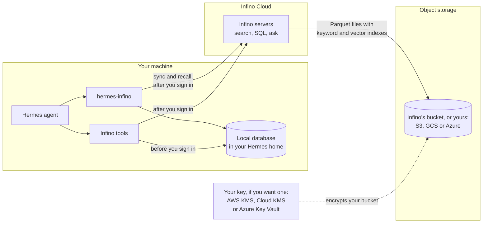
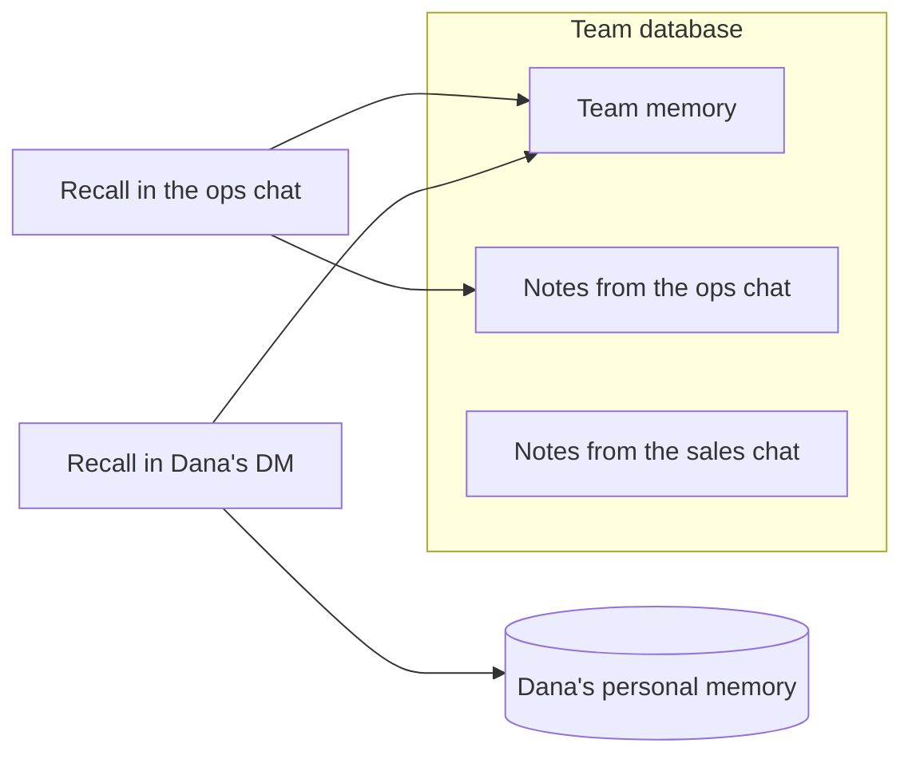

# Infinite recall for Hermes fleets

hermes-infino is a [Hermes Agent](https://github.com/NousResearch/hermes-agent) plugin that gives your teams of agents a durable, shared memory that scales. It keeps all agent data in Infino, an automated data layer for AI inference, storing memory, conversations, traces and skills. Before each agent turn, the plugin gives the agent the memories that matter for that turn, and the agent can search everything stored: the team's data in shared sessions and your personal data in your own sessions.

If are not signed in to an Infino account, everything stays on your machine, in databases run by Infino's open source engine.

When you [sign in](#signing-in) to Infino, everything is kept in Infino Cloud too and team collaboration becomes available. Work goes to a team database, and everyone who signs in to the same team database shares it, so every agent on the team can search what the others did. Personal memory, and any work you mark as personal, goes to a personal database of your own that is kept private.

## What it stores in Infino

The plugin keeps four tables.

**`memory`** holds the entries in Hermes's `MEMORY.md` and `USER.md`, including edits you make by hand, plus whatever the agent saves with `infino_remember`. A shared profile on a gateway keeps no `USER.md` entries. `infino_forget` deletes a memory, even one a teammate's agent saved.

**`conversations`** logs every message of every session a person has with the agent, and who sent it. Tool calls and tool results have their own columns. A message stays in the log even after context compression or `/undo` removes it from the session. Scheduled jobs and subagents add no conversation rows; their model and tool calls are in `traces`.

**`traces`** records every model call (model, provider, tokens, time) and every tool call (name, arguments, result, status, time). Secrets are masked the same way Hermes masks them for any memory plugin.

**`skills`** holds the skills your agents share with `infino_publish_skill`. Once you sign in, every profile on the team can use them as read-only `infino:<name>` skills, from its next session. Only the profile's owner publishes: from their own sessions, and on a profile marked personal, from a direct message or a webhook route listed in `INFINO_OWNER_ROUTES`. A scheduled job publishes as the chat it was made in. One made where you weren't the one talking (an API server session, a gateway `/background` run, a Kanban worker, a message from another agent) can't publish. Group chat members, a shared profile's gateway users, hosted rooms and messages from other agents can't. Secrets are masked first. A shared skill's name can have only letters, digits, `-` and `_`, the only names Hermes loads a plugin's skills under. Set `INFINO_TEAM_SKILLS=off` to keep a profile to its own skills.

A turn and its traces share a `session_id` and a `turn_id`, so you can join them. Every row has a `row_id`.

Teammates read each other's memories, so a memory names people ("Dana prefers…") instead of saying "the user". Recalled memories are marked as reference material, so the agent doesn't follow them as instructions.

## Where your data lives

An Infino database is just files. Each table is a set of Parquet files with keyword and vector indexes built in, and search and SQL read those files directly. On your machine, Infino's open source core engine runs inside Hermes and keeps the files on your disk. In Infino Cloud, your data lives on object storage, either Infino's or a bucket in your own AWS, Google Cloud or Azure account, and you can encrypt your bucket with a key you own (CMEK).



| | Where the files are | How they're encrypted |
| --- | --- | --- |
| **Your machine** | `$HERMES_HOME/infino/`, readable only by your user. Every row lands here first. | However your disk is encrypted |
| **Infino Cloud** | Infino's object storage. Each database has its own prefix, and its server gets a short-lived credential for that prefix only. | AES-256 at rest, with keys the cloud provider manages. Server disk caches are encrypted too. |
| **Your own bucket** | An S3, Google Cloud Storage or Azure Blob Storage bucket in your account ([bring your own bucket](https://infino.ai/docs/cloud/bring-your-own-bucket)). Infino reaches it through an identity you grant and can revoke. | However your bucket is encrypted. With [customer-managed keys](https://infino.ai/docs/cloud/customer-managed-keys) (CMEK), it's a key you own in AWS KMS, Google Cloud KMS or Azure Key Vault. Revoke the key, and Infino can no longer read the data. |

Your own bucket and key are turned on per account. Create the team database in your bucket first (the bring-your-own-bucket guide shows how), then [sign in](#signing-in) and name it with `--team-database`. To keep your personal database in your bucket too, create it there and sign in with `--personal-database`.

Infino Cloud is SOC 2 Type II. The report is available on request at [infino.ai/talk](https://infino.ai/talk).

### How your machine and the cloud stay in sync

Without an account, nothing leaves your machine. Each memory is embedded locally with all-MiniLM-L6-v2, and recall uses keyword and vector search together. Until the model is ready, recall uses keyword search alone.

Once you sign in:

- Every row is written to your machine first. It reaches the cloud a few seconds later, and Hermes sends whatever is left before it exits, waiting up to about ten seconds for the cloud. Anything still left goes with the next sync.
- If the cloud is down, nothing is lost. The sync picks up where it stopped.
- If the cloud refuses a row, it stays on your machine. `hermes infino status` counts such rows, names the file that lists them, and shows how far behind the cloud is in the sync.
- Forgetting a memory deletes it from the cloud too.
- The cloud embeds memories itself, so your machine no longer has to embed locally.
- Recall reads from the cloud first. If the cloud is slow or can't be reached, recall searches your local machine.

## Install

You need:

- Hermes, installed with its installer: `curl -fsSL https://hermes-agent.nousresearch.com/install.sh | bash`. The plugin is tested on Hermes 0.22.6, 0.22.7 and 0.23.0.
- Read access to the private repositories `infino-ai/hermes-infino` and `infino-ai/ask-bench`. Run `gh auth login`, then `gh auth setup-git`, so `git clone` in step 1 can use your GitHub sign-in. Hermes's installer in step 2 uses it too. It also reads a `GITHUB_TOKEN=<a token that can read them>` line in `~/.hermes/.env`, but `git clone` doesn't.

**1. Build the Infino client.** It needs Node.js 22.19 or newer. Hermes's installer puts one in `~/.hermes/tools/`.

```bash
git clone -b feat/local-database-mode https://github.com/infino-ai/ask-bench.git
cd ask-bench/client
export PATH="$(ls -d ~/.hermes/tools/node-*/bin | head -n 1):$PATH"
npm ci && npm run build
```

This builds `ask-bench/client/dist/cli.js`.

**2. Install the plugin.** Hermes installs its Python dependencies and makes it the memory provider.

```bash
hermes plugins install https://github.com/infino-ai/hermes-infino/tree/main/hermes_infino --enable --yes-deps
```

**3. Add the Infino tools**, with the full path to the client from step 1.

```bash
hermes config set mcp_servers.infino.command hermes
hermes config set mcp_servers.infino.args '["infino", "mcp"]'
hermes config set mcp_servers.infino.env.INFINO_CLIENT /full/path/to/ask-bench/client/dist/cli.js
hermes config set mcp_servers.infino.connect_timeout 120
```

Hermes starts the tools inside its own environment, with the Node its installer keeps. To use another Node, set `INFINO_NODE` in the same `env` block.

**4. Start `hermes`.** The first start downloads the embedding model in the background (about 90 MB, once). Until it's ready, recall uses keyword search.

## Signing in

`hermes infino login` creates a free account, on a platform that offers them, or joins your team with a key a teammate gives you.

```bash
hermes infino login                                         # create a free account, where the platform offers them
hermes infino login --api-key-file KEY --team-database TEAM  # join a team with a key
hermes infino status                                        # how far behind the cloud is
hermes infino sync                                          # send what the cloud doesn't have yet
```

To use another Infino platform, such as staging, add `--url`:

```bash
hermes infino login --url https://api.platform.staging.infino.ai --api-key-file KEY --team-database TEAM --yes
```

`login` shows what it will upload and asks before it creates or sends anything. Only a person at a terminal can agree to create an account. With a key someone gave you, `--yes` agrees to the upload. The key is saved in `$HERMES_HOME/infino/credentials.json`, readable only by you. A free account's key is given only once, so keep that file. To sign in again, save its `api_key` to a file first. Then remove `credentials.json` and run `hermes infino login` with `--api-key-file` and the saved key, `--team-database` and your team's database, and `--personal-database` and your personal database (or `--no-personal-database` if you have none), so your personal data stays in one database. Run `hermes infino login` while you're signed in and it prints that command.

A URL, team database, personal database or key set in the config block or `.env` takes precedence over a sign-in (see [Settings](#settings)). `login` uses the team and personal database set there. If one of those settings differs from what `login` would use, `login` stops before it creates or sends anything, and names the variable and where it's set. A personal database set to the team database counts as not set. A URL must start with `https://` or `http://`.

Once you're signed in, the plugin uploads what your machine has kept so far, then each new memory, conversation, trace and skill as it happens. Your machine keeps its own copy.

`login` also creates your personal database and prints its name. Its name is the team's plus a random suffix, such as `hermes-team-personal-3f9a1c2e`, so it's never shared with anyone. If `INFINO_PERSONAL_DATABASE` or `--personal-database` names one, `login` uses that one instead, and creates it if it doesn't exist. To use it from another machine, sign in there with `--personal-database` and that name. To keep personal data on this machine only, add `--no-personal-database`. Your personal database can't be the team database. If it can't be created, for example because your key may not create that database, you're still signed in, and personal data stays on your machine. To add one later without signing in again, run `hermes config set INFINO_PERSONAL_DATABASE <name>`, with a name that's yours alone. The next sync creates it, or uses it as it is if a database by that name already exists. A Hermes that's already running uses it after a restart.

A running Hermes picks up the sign-in within half a minute. The Infino tools switch to the cloud when Hermes restarts. Until then they search your machine's copy, which has everything too.

## Team memory and personal memory

A memory belongs to the team unless it's about one person. Nobody has to label it: the agent decides from what the memory says.

| Team memory | Personal memory |
| --- | --- |
| Decisions, conventions, fixes, who owns what, how things are set up | A person's preferences, credentials, schedule and private matters |
| Hermes's `MEMORY.md` | Hermes's `USER.md` |
| `infino_remember`, by default | `infino_remember`, when the agent marks it personal |

Personal memory lives in its own database. On your machine it's in `$HERMES_HOME/infino/personal`, and once you sign in it's in your personal database too. It never goes to the team database. When the agent saves a personal memory, `conversations` and `traces` record the tool call without the memory's text.

`conversations` keeps every message as it was written, including anything personal said in it. To keep a whole conversation out of the team database, [mark the work personal](#keeping-work-personal).

Personal memory belongs to the profile's owner. A shared profile on a gateway answers whoever writes to it, so it keeps no personal memory. On a profile that serves only you, such as your own bot, set `INFINO_PERSONAL_PROFILE=on`. Its chats can then keep your personal memory, and its conversations and traces stay personal too.

A scheduled job made in a gateway chat runs as that chat. It keeps no personal memory on a shared profile, and none on any profile if it was made in a group chat. Neither does a message another agent sends into your Bot Chat. A job made there gets no personal memory either, nor does any job made where you aren't the one talking and Hermes keeps no record of the chat: in an API server session (Open WebUI, a hosted room), a gateway `/background` run, or a Kanban worker. A job you make at the terminal, in the TUI or the Desktop, or with `hermes cron` is yours, and so is one made before this version.

## Keeping work personal

Conversations and traces go to the team database, so every agent can see what the others did. Some work is yours alone, such as a scheduled job that summarizes your email, or a profile for private errands. Mark it personal, and its conversations and traces go to your personal database instead, or stay on your machine if you don't have one.

| Setting | What becomes personal |
| --- | --- |
| `INFINO_PERSONAL_JOBS=email-digest,weekly-finances` | Every run of those scheduled jobs, named as `hermes cron list` shows them: every model call, tool call and subagent along the way, and the chat the output is delivered to |
| `INFINO_PERSONAL_PROFILE=on` | Every conversation and trace of the profile |

A subagent that Hermes runs as another profile keeps its traces personal on that profile, even for team work, since that profile can't tell whose work it is.

A chat becomes personal once a personal job's output is in its history, and stays personal from then on. The output gets there when the job uses `attach_to_session`, `cron.mirror_delivery` or a continuable thread, or posts to a group chat with `deliver: room:<id>`.

In a group chat, each member's turn runs on that member's own profile. List the job by its name on every member's profile, or once for the whole team through [Remote Config](#running-a-fleet): another profile sees only the job's name, never its id. If two of a profile's jobs share a name and either is listed, the output of both is personal. A member's turn is personal only when their profile lists the job and the turn still includes the job's post.

These settings don't change memory. A memory is still the team's unless it's about one person.

## Group chats

When Hermes is in a group chat through the gateway, memory belongs to that chat:

- What members ask the agent to remember is saved for that chat and credited to whoever said it. It never goes into anyone's personal memory.
- Recall in the group shows that chat's notes and the team's memory, never anyone's personal memory or other chats' notes.
- Recall anywhere else doesn't show that group's notes.
- Notes Hermes's background review saves after a group's turn stay with that chat, however long after the turn the review runs, and never go into anyone's personal memory. A note the reviews of several groups both saved shows in no chat's recall, and any of those chats can forget it. An entry you add to `MEMORY.md` or `USER.md` by hand is yours.



Hermes tells the plugin which chat a message came from. Any chat that isn't a direct message counts as a group, including one whose type Hermes can't tell, and nobody writes to the owner's personal memory from a group. With Hermes's proposed channel memory ([#144822](https://github.com/NousResearch/hermes-agent/pull/144822)), its setting for each chat decides instead. A chat whose type Hermes can't tell may be your own direct message behind a relay. So asking for a personal memory there is refused instead of being saved for the chat, and a `USER.md` entry written there is kept nowhere.

**Webhooks.** A webhook route on Hermes's webhook platform (a GitHub event, an email, an alert) works like a group chat of its own. What the agent saves during one delivery is kept for that route and recalled in its later deliveries. It isn't recalled in other chats or routes, and never goes into anyone's personal memory, since a webhook's content comes from outside: asking for a personal memory there is refused. On a profile marked personal, list the routes whose events are your own business in `INFINO_OWNER_ROUTES`, such as `review-requested,my-alerts`. Their turns are then yours, with your personal memory, like a turn at the terminal.

**The Infino tools search the whole team database.** Recall keeps each chat's notes to that chat, but an agent can use the tools to read another chat's notes and conversations.

## The Infino tools

Hermes runs the Infino client as an MCP server, started with `hermes infino mcp` from the `mcp_servers.infino` entry in `config.yaml`. Its tools depend on whether you're signed in:

- **Not signed in:** `search`, `find`, `sql` and `read`, over the database on your machine.
- **Signed in:** `ask`, `search`, `find`, `sql` and `join_keys`, over your team's database in the cloud. `ask` is Infino's retrieval agent: give it a question, and it returns the rows that answer it, with where they came from.

The Infino tools search the team database. Your personal data is searched with `infino_personal_search`, a tool of the plugin's own: keyword search over your personal memory, conversations and traces. The agent has it in your own sessions, and on a profile marked personal, but never in a group chat or on a shared profile. Once a session uses it, that session's conversation and traces stay personal. A memory the session saves still follows the memory rule: it's the team's unless it's about one person.

The API key reaches the client through its environment, never its command line. Hermes doesn't pass an MCP server's instructions to the model, so the plugin puts them in the system prompt.

Hermes's tool search, on by default, shows the model only the name and first sentence of each MCP tool until the model asks for more. To give the model the Infino tools' full descriptions up front, turn it off:

```bash
hermes config set tools.tool_search.enabled off
```

## Running a fleet

You don't need to run `login` on every machine. Put the team's settings in the `env` block of the Infino tools' entry in `config.yaml`, and the plugin and its tools both read them from there:

```yaml
memory:
  provider: infino
mcp_servers:
  infino:
    command: hermes
    args: [infino, mcp]
    env:
      INFINO_CLIENT: /path/to/client/dist/cli.js
      INFINO_FLEET_TEAM_DATABASE: support-team
      INFINO_FLEET_API_KEY: ${INFINO_API_KEY}    # a reference; the key itself is in the profile's .env
    connect_timeout: 120
```

In this block, write the key, team database and URL as `INFINO_FLEET_API_KEY`, `INFINO_FLEET_TEAM_DATABASE` and `INFINO_FLEET_URL`. Hermes starts the Infino tools with the block as their environment, and the tools then load the profile's `.env` over it, as every `hermes` command does. Nothing writes these names into `.env`, so the plugin and its tools both use the block's values, whatever else `.env` holds, with a config file or with Remote Config.

With Hermes's [Remote Config](https://github.com/NousResearch/hermes-agent/pull/122509) (Hermes 0.22.6 and later, turned on with `HERMES_CONFIG_BACKEND=remote`), these settings come from the config service instead of a file. An administrator sets the team database once, and every agent on the team starts with it. Remote Config won't store a key written out in full, so keep `INFINO_FLEET_API_KEY` as a `${INFINO_API_KEY}` reference and put the key in each profile's `.env`. `hermes infino status` shows where the settings came from.

Write every value in the `env` block as text. YAML reads a bare `on`, `off`, `yes`, `no`, `true` or `false` as a boolean, and reads numbers and lists as numbers and lists. Hermes passes them to the Infino tools as they are, and the tools won't start. So quote them, as in `INFINO_PERSONAL_PROFILE: "on"`, and write jobs as one string, as in `INFINO_PERSONAL_JOBS: "email-digest,weekly-finances"`. The plugin's log names any value that isn't text. `hermes config set` stores these values as booleans, numbers and lists too, so edit `config.yaml` instead, or put the setting in `.env`, for example with `hermes config set INFINO_PERSONAL_PROFILE on`.

A profile set up this way uses the personal database from its `login` only while its key is the one it signed in with. With another key, it has no personal database unless you name one with `INFINO_PERSONAL_DATABASE`. Without one, its personal memory and personal work stay on that machine.

## Settings

Each setting comes from the first of these that has it:

1. the `env` block of `mcp_servers.infino` in the profile's config (a file or Remote Config)
2. the profile's own environment (`.env`). On a gateway that serves several profiles, or the desktop app serving another profile, each profile reads only its own `.env`, never that of the profile Hermes was started with.
3. the sign-in saved by `hermes infino login`

The key, team database and URL, under their `INFINO_FLEET_` names in the block, come first for the plugin and for the Infino tools alike, so both always use the same team, whatever `.env` says. Under their usual names in the block, the tools read them from `config.yaml` themselves. With Remote Config they can't: if `.env` sets the same name, the tools use the `.env` value while the plugin uses the block's. A `${VAR}` reference to a variable that isn't set counts as not set.

The sign-in's URL and personal database go with its key. They apply only when the key in use is the sign-in's, so another key, from the config block or `.env`, never goes to the sign-in's platform or writes to its personal database.

| Variable | What it is |
| --- | --- |
| `INFINO_API_KEY` | The Infino API key for this person or bot |
| `INFINO_TEAM_DATABASE` | The team's database |
| `INFINO_PERSONAL_DATABASE` | Your own database. `login` creates one. Leave it unset for bots and shared profiles. If it names the team database, it counts as not set. |
| `INFINO_AUTHOR` | Who this profile's messages and memories are from, when Hermes doesn't say (default: the profile's name, on every surface, never the machine's user id). In a chat, the sender is the author. |
| `INFINO_MCP_SERVER` | The client's name under `mcp_servers` (default `infino`). Environment only, since it names the config block. |
| `INFINO_URL` | The Infino Cloud URL (default `https://api.platform.infino.ws`) |
| `INFINO_TEAM_SKILLS` | `off` stops this profile loading the skills teammates publish (default on) |
| `INFINO_PERSONAL_PROFILE` | `on` keeps this profile's conversations and traces out of the team database, and lets its gateway chats keep personal memory (default off). Any value other than `off`, `false`, `no` or `0` counts as `on`. |
| `INFINO_PERSONAL_JOBS` | Scheduled jobs (names or ids, comma-separated) whose runs, and the chats their output is delivered to, stay out of the team database. On a profile other than the job's own, name the job, not its id. |
| `INFINO_OWNER_ROUTES` | On a profile marked personal, the webhook routes (comma-separated) whose events are your own: their turns read and write your personal memory. Ignored on a shared profile. |
| `INFINO_FLEET_API_KEY`, `INFINO_FLEET_TEAM_DATABASE`, `INFINO_FLEET_URL` | The key, team database and URL, written in the `env` block (see [Running a fleet](#running-a-fleet)). They come before every other setting of the same kind. |

## Development

From a Hermes checkout, with its environment activated (`source ./activate`) and pytest and the plugin's dependencies installed:

```bash
PYTHONPATH=$PWD:$PYTHONPATH python -m pytest tests
```

Each module has its own test file, `tests/test_<module>.py`. `tests/test_plugin.py` runs the plugin end to end, with Hermes's own `MemoryManager`, the real Infino engine for the local database, and a fake Infino Cloud.
