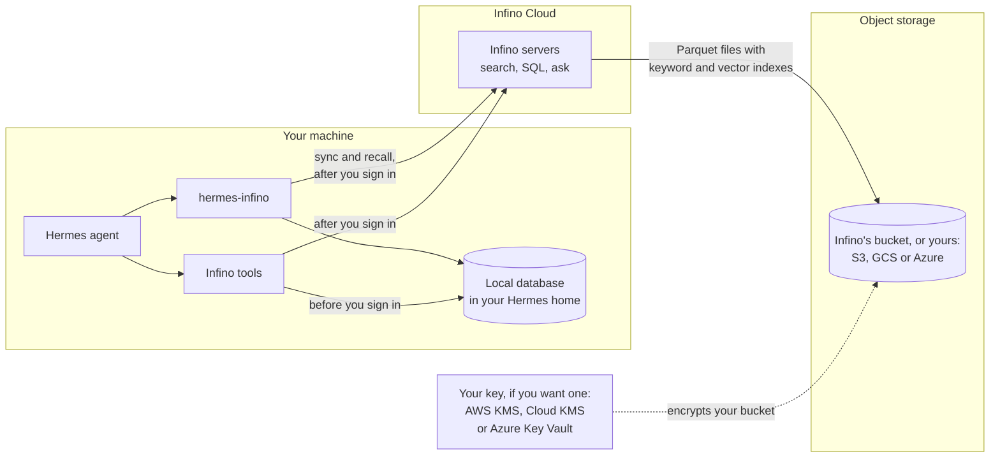
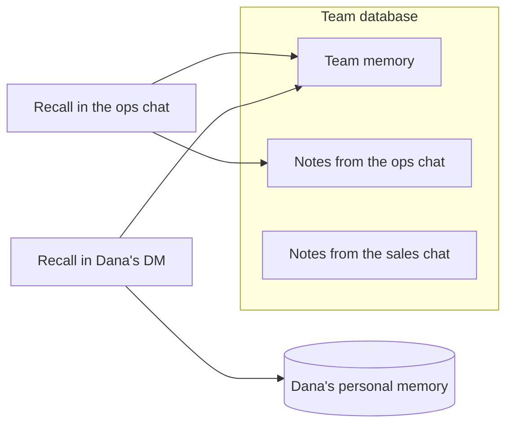

# Infinite recall for Hermes agents

hermes-infino is a [Hermes Agent](https://github.com/NousResearch/hermes-agent) plugin that gives your agents a memory that lasts. It saves four things into Infino: memory, conversations, traces, and skills, including across teams and Hermes fleets. Before each turn it gives the agent the memories that matter for that turn, and the agent can search all history with the Infino tools.

By default, everything is kept in a database on your machine using Infino's open source retrieval engine, and nothing leaves your device.

However, with an Infino account, your team shares a database in Infino Cloud, so every agent on the team can search what the others did. Personal memory, and any work you mark as personal, stays out of it. [Signing in](#signing-in) says what gets uploaded and when.

In Infino Cloud, your data lives on object storage, either Infino's or a bucket in your own AWS, Google Cloud or Azure account, and you can encrypt your bucket with a key you own (CMEK). See [Where your data lives](#where-your-data-lives).

## What it saves

The plugin keeps four tables.

**`memory`** holds everything in Hermes's `MEMORY.md` and `USER.md`, whoever wrote it: the agent, Hermes's background memory review, or you editing the file by hand. It also holds whatever the agent saves with the `infino_remember` tool. `infino_forget` deletes a memory, even one a teammate's agent saved.

**`conversations`** is a log of every message in every session and who sent it, with tool calls and tool results in their own columns. Because it's a log, nothing disappears from it when context compression shortens a session or `/undo` takes back a turn.

**`traces`** records every model call (model, provider, tokens, time taken) and every tool call (name, arguments, result, status, time taken). Secrets in arguments and results are masked the same way Hermes masks anything it hands a memory plugin.

**`skills`** holds the skills your agents share with `infino_publish_skill`. Once you're signed in, every profile on the team can use them as read-only `infino:<name>` skills, and each one's description says who published it. Only a profile's owner can publish (members of a group chat can't), and secrets are masked before a skill is shared. Set `INFINO_TEAM_SKILLS=off` to keep a profile to its own skills.

A conversation turn and its traces share a `session_id` and a `turn_id`, so you can join them, and every row has a `row_id`.

Teammates read each other's memories, so a memory names the person it's about ("Dana prefers…") instead of saying "the user". When recalled memories are added to a turn, they're marked as reference material, so the agent doesn't take them as instructions.

## Where your data lives

An Infino database is just files. Each table is a set of Parquet files with keyword and vector indexes built in, and search and SQL read those files directly. On your machine, the Infino engine runs inside Hermes and keeps the files on your disk. In Infino Cloud, Infino's servers keep them on object storage and cache what they read.



| | Where the files are | How they're encrypted |
| --- | --- | --- |
| **Your machine** | `$HERMES_HOME/infino/`, in folders only your user can read. Every row lands here first, whether or not you're signed in. | However your disk is encrypted |
| **Infino Cloud** | Infino's object storage. Each database has its own prefix, and the server for a database gets a short-lived credential that reaches only that prefix. | AES-256 at rest, with keys the cloud provider manages. The servers' disk caches are encrypted too. |
| **Your own bucket** | An Amazon S3, Google Cloud Storage or Azure Blob Storage bucket in your account ([bring your own bucket](https://infino.ai/docs/cloud/bring-your-own-bucket)). Infino reaches it through an identity you grant, and you can take that grant back at any time. | However your bucket is encrypted. With [customer-managed keys](https://infino.ai/docs/cloud/customer-managed-keys) (CMEK), that's a key you own in AWS KMS, Google Cloud KMS or Azure Key Vault. Infino never holds the key: disable or revoke it, and Infino can no longer read the data. |

Infino turns on your own bucket and your own key per account. To use them, create the team database in your bucket first (the bring-your-own-bucket guide walks you through it), then [sign in](#signing-in) and name it with `--team-database`. `login` uses a database that already exists as it is. Your personal database can live in your bucket too.

Infino Cloud is SOC 2 Type II, and the report is available on request at [infino.ai/talk](https://infino.ai/talk).

### How your machine and the cloud stay in sync

Without an account, everything is stored under `$HERMES_HOME/infino/` and nothing leaves your machine. Each memory is embedded locally with all-MiniLM-L6-v2 (384 dimensions), and recall uses keyword and vector search together. If the model is still loading, or couldn't be downloaded, recall uses keyword search alone.

Once you sign in, every row is still written to your machine first, and a sync sends it on to the cloud a few seconds after each write, and once more before Hermes exits:

- Rows go up in the order they were saved, and the sync picks up where it left off. If the cloud is down, nothing is lost. If an upload is cut off partway, the batch is checked against the cloud before it's sent again.
- If the cloud refuses a row outright, the row stays on your machine and `hermes infino status` lists it. `status` also shows how far behind the cloud is and, if the sync stopped, why.
- Forgetting a memory deletes it from the cloud too.
- The cloud embeds memories itself, so your machine stops embedding them.
- Recall reads the cloud first and adds any rows from your machine that the cloud doesn't have yet. If the cloud can't be reached or is slow to answer, recall searches your machine's own rows by keyword.

## Install

These steps were run as written on a fresh machine with Hermes's own installer.

**Before you start**, you need:
- Hermes, installed with its installer: `curl -fsSL https://hermes-agent.nousresearch.com/install.sh | bash`. The plugin is tested on Hermes 0.22.6, 0.22.7 and 0.23.0.
- Access to the two private repositories, `infino-ai/hermes-infino` and `infino-ai/ask-bench`. Hermes clones the plugin with your GitHub sign-in, so run `gh auth login` first, or put `GITHUB_TOKEN=<a token that can read the repos>` in `~/.hermes/.env`.

**1. Build the Infino client.** It needs Node.js 22.19 or newer, and Hermes's installer has already put one in `~/.hermes/tools/`.

```bash
git clone -b feat/local-database-mode https://github.com/infino-ai/ask-bench.git
cd ask-bench/client
export PATH="$(ls -d ~/.hermes/tools/node-*/bin | head -n 1):$PATH"
npm ci && npm run build
```

That gives you `ask-bench/client/dist/cli.js`.

**2. Install the plugin.** Hermes installs its Python dependencies and makes it the memory provider (`memory.provider: infino`).

```bash
hermes plugins install https://github.com/infino-ai/hermes-infino/tree/main/hermes_infino --enable --yes-deps
```

**3. Add the Infino tools**, using the full path to the client you built in step 1.

```bash
hermes config set mcp_servers.infino.command hermes
hermes config set mcp_servers.infino.args '["infino", "mcp"]'
hermes config set mcp_servers.infino.env.INFINO_CLIENT /full/path/to/ask-bench/client/dist/cli.js
hermes config set mcp_servers.infino.connect_timeout 120
```

Hermes starts the tools with `hermes infino mcp`, inside its own environment (where the plugin's dependencies are) and on the Node its installer keeps. To use a different Node, set `INFINO_NODE` in the same `env` block.

**4. Start `hermes` as usual.** Everything stays on your machine until you sign in. The first start downloads the embedding model from Hugging Face in the background (about 90 MB, once). Until it's ready, memories are found by keyword, and anything saved in the meantime is embedded as soon as the model is ready.

## Signing in

`hermes infino login` either creates a free account, on a platform that gives them out, or joins your team with a key a teammate gives you.

```bash
hermes infino login                          # create a free account, on a platform that gives them out
hermes infino login --api-key-file KEY \
  --team-database TEAM [--personal-database ME]   # join a team with a key someone gave you
hermes infino status                         # how far behind the cloud is
hermes infino sync                           # send what the cloud doesn't have yet, now
```

To use a different Infino platform, such as staging, add `--url`:

```bash
hermes infino login --url https://api.platform.staging.infino.ai --api-key-file KEY --team-database TEAM --yes
```

Before it creates or sends anything, `login` shows you exactly what will be uploaded and asks you to confirm. Creating an account always needs a person at a terminal: without one, `login` refuses, and no flag can answer for you. When you sign in with a key someone gave you, `--yes` confirms the upload. The key is saved in `$HERMES_HOME/infino/credentials.json`, which only you can read.

Once you're signed in, the plugin uploads everything your machine has kept so far, then each new memory, conversation, trace and skill as it happens. Your machine keeps its own copy.

If Hermes is already running, it picks up the sign-in within half a minute, and recall and writes go to the cloud from then on. The Infino tools switch over when Hermes restarts. Until then they search the copy on your machine, which has everything too.

## Team memory and personal memory

A memory belongs to the team unless it's about one person. Nobody has to label it: the agent decides from what the memory says.

| Team memory | Personal memory |
| --- | --- |
| Decisions, conventions, fixes, who owns what, how things are set up | A person's preferences, credentials, schedule and private matters |
| Hermes's `MEMORY.md` | Hermes's `USER.md` |
| `infino_remember`, by default | `infino_remember`, when the agent marks it personal |

Personal memory lives in a database of its own, and the Infino tools never open it, so no other agent and no chat can read it. On your machine it's in `$HERMES_HOME/infino/personal`. When you sign in, it goes to your personal database (`--personal-database`), or stays on your machine if you don't have one. Either way, it never reaches the team database. When the agent saves a personal memory, the tool call still shows up in `conversations` and `traces`, but without the memory's text.

A conversation, on the other hand, is kept as it happened. `conversations` records every message as it was written, including anything personal someone says. To keep a whole conversation out of the team database, mark the work personal (see the next section).

Personal memory belongs to one person: the profile's owner. Nothing can separate two people's memories inside one database, so a shared profile on a gateway, which answers whoever writes to it, keeps no personal memory at all. The agent is told it can't save anything personal there, and recall in those chats shows none. A profile that belongs to one person, such as your own bot, can keep your personal memory in its chats too: set `INFINO_PERSONAL_PROFILE=on`, which also keeps its conversations and traces personal.

## Keeping work personal

Conversations and traces belong to the team, so every agent can see what the others did. But some work is just yours: a scheduled job that reads your email and sends you a digest, or a profile you keep for private errands. Mark that work personal, and its conversations and traces go where your personal memory goes: your personal database, or your machine if you don't have one. They never reach the team database.

| Setting | What becomes personal |
| --- | --- |
| `INFINO_PERSONAL_JOBS=email-digest,weekly-finances` | Every run of those scheduled jobs (by name or id, as `hermes cron list` shows them), including every model and tool call along the way and any subagents the job starts. The chat the output is delivered into becomes personal too (see below). |
| `INFINO_PERSONAL_PROFILE=on` | Every conversation and trace of the profile |

A job's output can land in a chat. When Hermes adds it to the chat's history (`attach_to_session`, `cron.mirror_delivery`, or a continuable thread), or posts it into a group chat (`deliver: room:<id>`), that chat's conversation and traces are personal from then on.

Group chats need one more step. Each member's turn runs as that member's own profile, possibly on another machine, and reads the setting from there. So list the job on every member's profile, or once for the whole team through Remote Config (see [Running a fleet](#running-a-fleet)). If a member's profile doesn't list the job, that member's turn, including the job's post and the answer to it, goes to the team. Hermes also trims each member's turn to its newest messages, so after several long replies a member may see a reply that quotes the job's output without the job's own post, and that turn goes to the team.

A personal job still uses the team's skills like any other, but what it reads and writes stays with you. Memory keeps its own rule (team unless it's about one person), whatever these settings say.

## Group chats

When Hermes is in a group chat through the gateway, memory belongs to that chat:

- What members ask the agent to remember is saved for that chat and credited to whoever said it. It never goes into anyone's personal memory.
- Recall in the group shows that chat's notes and the team's memory, never anyone's personal memory or other chats' notes.
- Recall anywhere else, in a direct message or another group, doesn't show that group's notes.



Hermes tells the plugin which chat a message came from and whether it's a group. Any chat Hermes doesn't treat as a direct message counts as a group, and nobody writes to the owner's personal memory from a group. Hermes's channel memory ([#144822](https://github.com/NousResearch/hermes-agent/pull/144822)) is a proposal and isn't in any Hermes release. In a Hermes that has it, its setting for the chat decides instead, including whether someone may write to the owner's personal memory from a group.

**The Infino tools don't separate chats.** Recall keeps each chat's notes to that chat, but the tools search the whole team database, so an agent can use them to find another chat's notes and conversations. Separating chats in the tools needs per-chat permissions, which this version doesn't have.

## The Infino tools

Hermes runs the Infino client as an MCP server, started with `hermes infino mcp` from the `mcp_servers.infino` entry in `config.yaml`. Each time it starts, it checks whether you're signed in:

- **Not signed in:** `search`, `find`, `sql` and `read`, over the database on your machine.
- **Signed in:** `ask`, `search`, `find`, `sql` and `join_keys`, over your team's database in the cloud. `ask` is Infino's retrieval agent: give it a question, and it runs the searches and joins and returns the rows it found, with where they came from.

The API key reaches the client through its environment, never its command line. Hermes doesn't show an MCP server's instructions to the model, so the plugin adds them to the system prompt.

Hermes's tool search is on by default. It shows the model only each MCP tool's name and the first sentence of its description until the model asks for more. To give the model the Infino tools' full descriptions up front, turn it off:

```bash
hermes config set tools.tool_search.enabled off
```

## Running a fleet

You don't have to run `login` on every machine. Put the team's settings in the `env` block of the Infino tools' entry in `config.yaml`, and the plugin and its tools both read them from there:

```yaml
memory:
  provider: infino
mcp_servers:
  infino:
    command: hermes
    args: [infino, mcp]
    env:
      INFINO_CLIENT: /path/to/client/dist/cli.js
      INFINO_TEAM_DATABASE: support-team
      INFINO_API_KEY: ${INFINO_API_KEY}    # a reference; the key itself is in the profile's .env
    connect_timeout: 120
```

With Hermes's [Remote Config](https://github.com/NousResearch/hermes-agent/pull/122509) (Hermes 0.22.6 and later, turned on with `HERMES_CONFIG_BACKEND=remote`), the same keys come from the config service instead of a file. An administrator sets the team database once, at the team (group) level, and every agent on the team starts with it. Remote Config refuses a key written out in full, so leave `INFINO_API_KEY` as a `${INFINO_API_KEY}` reference and put the key itself in each profile's `.env`. `hermes infino status` tells you where the settings came from ("from the config").

## Settings

The plugin takes each setting from the first of these that has a value:

1. the `env` block of `mcp_servers.infino` in the profile's config (a file or Remote Config)
2. the profile's environment (`.env`)
3. the sign-in saved by `hermes infino login`

The config block comes first because Hermes starts the Infino tools with that block as their environment, so the plugin and its tools always agree on the team. A `${VAR}` reference to a variable that isn't set counts as not set.

| Variable | What it is |
| --- | --- |
| `INFINO_API_KEY` | The Infino API key for this person or bot |
| `INFINO_TEAM_DATABASE` | The team's database |
| `INFINO_PERSONAL_DATABASE` | This person's own database. Leave it unset for bots and shared profiles. |
| `INFINO_AUTHOR` | Who this profile's messages and memories are from, when Hermes doesn't say. In a chat, the sender is always the author, and a message with no sender is saved without one. |
| `INFINO_MCP_SERVER` | The client's name under `mcp_servers` (default `infino`). Set it in the environment only, since it names the config block. |
| `INFINO_URL` | The Infino Cloud URL (default `https://api.platform.infino.ws`) |
| `INFINO_TEAM_SKILLS` | `off` stops this profile loading the skills teammates publish (default on) |
| `INFINO_PERSONAL_PROFILE` | `on` keeps every conversation and trace of this profile out of the team database, and lets its gateway chats keep personal memory as one person's (default off). See [Keeping work personal](#keeping-work-personal). |
| `INFINO_PERSONAL_JOBS` | Scheduled jobs (names or ids, comma-separated) whose runs, and the chats their output is delivered into, stay out of the team database |

## Development

From a Hermes checkout, with its environment activated (`source ./activate`) and pytest and the plugin's dependencies installed in it:

```bash
PYTHONPATH=$PWD:$PYTHONPATH python -m pytest tests
```

Each module has its own test file (`tests/test_<module>.py`), and `tests/test_plugin.py` runs the plugin end to end. The tests use Hermes's own `MemoryManager`, the real Infino engine for the local database (with a stand-in for the embedding model), and a fake Infino Cloud.
